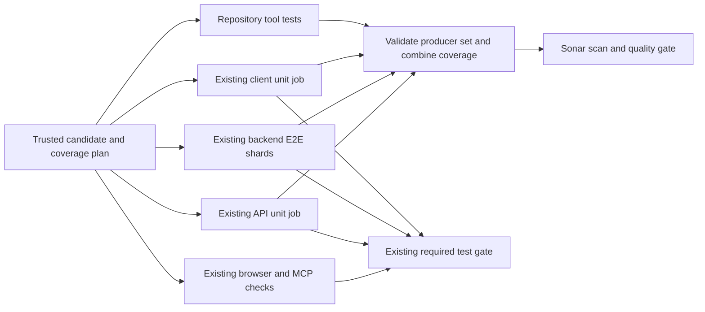

# Single-pass qualification and release handoff

Status: broader design prepared; bounded tag-reuse source merged, activation unproved. Environment: CI,
release publication and the read-only infrastructure promotion consumer.
Source baseline: main de34e07d638706506e23cce6f855beebb91532e8, 2026-10-20.
Owner: this release/unblock workstream. Separate from PR #1365's preparation-only evidence reuse.

## October 22 first slice: exact-main evidence on version tags

Source from [#1371](https://github.com/Midtown-Technology-Group/bifrost/pull/1371)
merged as `65297178502e0540805ab92d937d326bd97d4e11` under Thomas's separately
recorded exact-PR queue override. Original PR CI was still running at merge;
pending Sonar coverage/analysis is not a pass. No deployment or further control
cutover is authorized by this document. Owner: the existing Codex release thread, with
Eddie coordinating review in [Eddie #13](https://github.com/MTG-Thomas/Eddie/issues/13).
Delivery lane 3 applies to CI provenance; this does not reopen the broader
governance/design exercise below.

Outcome: when a version tag names the exact successful main-push commit, reuse
that main run's comprehensive Sonar reports and retain its original scanner
task provenance. The tag does not submit or claim a new Sonar analysis. This
removes a duplicate collector from final workflow completion, without changing
the final-version image builds, tag tests, artifact content qualification,
attestations, release approval or promotion consumer's success requirement.

The consumer accepts one completed/successful same-repository main-push CI run,
one exact producer attempt, successful coverage and actual scan/verification
steps, and two unique unexpired artifacts uploaded inside their respective job
intervals. It verifies GitHub archive digests before reading fixed files. The
original manifest, source inventory, configuration hashes, head/base and report
bytes pass the existing preflight again without restamping. Original Python,
Node, Docker/Compose and test-image identities are retained alongside the exact
source tree/workflow identity. A final run readback rejects an attempt changed
during retrieval. Producer and consumer run/attempt/ref remain separate.

Missing, incompatible, altered or unavailable evidence does not emit a reuse
success output: the existing comprehensive collector runs. Old artifacts that
lack the new producer/toolchain receipt are deliberately ineligible. A local
execution error may fail closed; it cannot silently satisfy coverage. PR/main
collection and their actual Sonar submission conditions remain unchanged.
Main's additional producer-metadata export is optional: failure to retain it
does not turn successful existing quality checks red, but makes reuse
ineligible. The tag then performs the original collection. No existing test,
report validation, analysis or teardown failure is made optional.

Thomas explicitly approved adding only `actions: read` to the collector job
for this transport. No `checks: write`, credential, repository permission,
branch protection, human review or production access change is part of it.

Acceptance evidence: remote execution of the existing Sonar preflight fixture
with genuine report verification, a valid original-base reuse, wrong
source/configuration/run/attempt refusal, failed/skipped/missing scan refusal,
expired or corrupt artifact refusal, unchanged report bytes and task identity,
rerun-race refusal and fallback without a forged success output. Existing CI
must qualify the clean candidate; no new required workflow is introduced.
The October 22 live audit binds both runs to exact source
`4048e4bd33d327e9e77e2a0a559d94a9db0ee9c7`, attempt 1:

| Existing receipt | Started UTC | Completed UTC | Result |
| --- | --- | --- | --- |
| [Main coverage 119606494182](https://github.com/Midtown-Technology-Group/bifrost/actions/runs/39712263857/job/119606494182) | 02:37:18 | 03:55:56 | Success |
| [Main analysis 119629565614](https://github.com/Midtown-Technology-Group/bifrost/actions/runs/39712263857/job/119629565614) | 03:55:59 | 04:02:12 | Actual analysis succeeded |
| [Tag coverage 119633083348](https://github.com/Midtown-Technology-Group/bifrost/actions/runs/39720162215/job/119633083348) | 04:08:08 | 05:03:20 | Success; repeated collection |
| [Create Release 119639279438](https://github.com/Midtown-Technology-Group/bifrost/actions/runs/39720162215/job/119639279438) | 04:28:56 | 04:31:00 | Success |

Tag analysis job `119649354416` was skipped. The duplicate collector lasted
55m12s and ended 32m20s after Create Release; do not describe this as a
55-minute delay in artifact publication. It prolonged whole-run success and
therefore the existing infra consumer's qualification wait. This is a measured
historical tail, not a demonstrated speedup for the new implementation.

Non-goals: single-pass producer/shard redesign, PR-to-main tree projection,
Sonar plan or effective-settings changes, skipping tag tests or image content
checks, release-policy exceptions, production acceptance reruns, or upstream
capability migration. This slice does not close all of the incident contract.

Rollback: revert this source change through normal review. Tags resume the
original collector; original main artifacts and failure evidence are retained.
No runtime/schema rollback is involved. No latency saving is claimed until a
post-merge main producer and its tag consumer exercise the transport.

The [October 19–20 incident report](2026-10-20-release-process-incident.md)
records the complete wall-clock history, root causes, owned corrective slices
R1–R6 and end-to-end acceptance cases A1–A14. This design must satisfy that
contract; optimizing the coverage collector alone does not close the incident.

## October 22 SDLC integration: relevant tests and explainable delivery

This section updates this plan; [Eddie #13](https://github.com/MTG-Thomas/Eddie/issues/13)
remains its coordination record. The October 20 baseline above is historical.
The goal is low manual intervention and verified delivery that an operator can
explain from the existing receipts. No new framework, status store or required
check is proposed. Environment: docs-only; nothing here activates CI, release,
permission, approval or production changes.

### State of the work

| Status | Scope and evidence | Remaining limit |
| --- | --- | --- |
| Implemented | Existing Python/TypeScript dependency planning and surface-specific fallback in [the planner](../../api/scripts/plan_affected_tests.py), shared by CI and `test.sh pre-pr`; obsolete PR runs are cancelled while main/tag runs are retained by [CI concurrency](../../.github/workflows/ci.yml). | Repository tools and workflow callers are not modelled; `.github/` changes still select comprehensive app validation. This is not the desired final selector. |
| Implemented | Preparation recovery/evidence slices #1363/#1365 and the incident/design record #1367 landed. [Production acceptance](https://github.com/MTG-Thomas/bifrost-infra/issues/177#issuecomment-6336156202) establishes the 3.2.0 deployment finish line. | These do not complete R1–R6/A1–A14. Merges and tags alone establish neither deployment nor a simplified release process. |
| In progress: qualification | [#1371](https://github.com/Midtown-Technology-Group/bifrost/pull/1371), reviewed candidate `99f7073bf6f78bea08fb943f91180cd14d4a85ed`, is merged as `65297178502e0540805ab92d937d326bd97d4e11`; it adds exact-main reports/analysis provenance reuse on tags. VM101 passed 17 focused tests, 153 Sonar contract tests and exact-candidate pre-PR validation; [review response](https://github.com/Midtown-Technology-Group/bifrost/pull/1371#discussion_r4348469452). | PR CI was still running at merge; current checks must be read live. Pending analysis is not a pass; first live producer/consumer reuse remains unproved. Thomas's separately recorded exact-PR override is not general policy. Do not cancel its current CI for this plan update. |
| Proposed | Repository-tool ownership, workflow-caller closure, explicit skip accounting, single-pass report production and a publication-free reuse rehearsal, below. | Source review and transition evidence precede activation; existing controls remain. |
| Deferred | Cache changes, further sharding/overlap, queue-cause hypotheses and upstream capability migration. | Measure a concrete bottleneck first. No claim that these are deployed or that an unknown queue caused the incident. |

### Lessons adopted from T3 Code

Public source was inspected at immutable snapshot
[`f054d1b8018721bd997d99cbb918a7b17bf098a4`](https://github.com/pingdotgg/t3code/tree/f054d1b8018721bd997d99cbb918a7b17bf098a4).
These are design inputs, not authority to copy T3's repository settings.

| Source lesson | BiFrost application and status |
| --- | --- |
| [Selection](https://github.com/pingdotgg/t3code/blob/f054d1b8018721bd997d99cbb918a7b17bf098a4/.github/scripts/ci-changes.cjs) follows package dependents and explicit test-only/hidden dependencies; unknown paths broaden. [CI](https://github.com/pingdotgg/t3code/blob/f054d1b8018721bd997d99cbb918a7b17bf098a4/.github/workflows/ci.yml) retains a full Linux main backstop. | Proposed: extend our existing graph to `scripts/sonar`, owning tests and reusable workflow callers. Do not infer that all `.github` changes are cheap: T3's unknown workflow paths also broaden. Distinguish a deliberate main backstop from accidental repetition across every release stage. |
| T3's same [CI source](https://github.com/pingdotgg/t3code/blob/f054d1b8018721bd997d99cbb918a7b17bf098a4/.github/workflows/ci.yml#L473-L517) has a stable `Check` result that accepts skips only when the selector requested them. PR supersession preserves main. | Proposed skip accounting: selected jobs must succeed; missing evidence, cancellation and unexplained skips refuse. Reuse existing summaries and qualification results before considering any additional gate. PR cancellation already exists here; preserve publication/deployment operations. Measure queue, setup and execution separately before changing sharding or overlap. |
| [Dependency setup](https://github.com/pingdotgg/t3code/blob/f054d1b8018721bd997d99cbb918a7b17bf098a4/.github/actions/setup-ci-deps/action.yml) binds cache keys to runtime/package-manager/platform/lock inputs and documents a slower cross-filesystem sticky-disk experiment. | Deferred: measure end-to-end restore/install cost and real toolchain identity before adding cache machinery. A cache hit is not correctness evidence. Do not transplant T3's runner, cache or dependency versions. |
| [Release operations](https://github.com/pingdotgg/t3code/blob/f054d1b8018721bd997d99cbb918a7b17bf098a4/docs/operations/release.md) separates manual preview from updater feeds. Manual stable normally builds the published nightly's SHA; stable still rebuilds, and tag-triggered releases differ. | Proposed: a bounded non-customer rehearsal of our actual evidence transition. Do not describe T3 as promoting identical binaries or use a customer stable release merely to test CI transport. |
| [Release workflow](https://github.com/pingdotgg/t3code/blob/f054d1b8018721bd997d99cbb918a7b17bf098a4/.github/workflows/release.yml) orders publication after its checks/backing artifacts and retains running publishers. | Preserve BiFrost's immutable image subjects, signatures, migration compatibility, tenant isolation, retained-work and independent runtime receipts. Desktop packaging/smoke evidence cannot substitute for those. Customer activation remains separate from code admission and artifact qualification. |
| [Contribution guidance](https://github.com/pingdotgg/t3code/blob/f054d1b8018721bd997d99cbb918a7b17bf098a4/CONTRIBUTING.md#L51-L119) asks for one underlying problem, relevant cross-layer changes, reproduction/environment, exact verification and untested limits. It distinguishes intended triage from deployed automation. | Adopt this work-packet discipline now; do not add a template bureaucracy. Do not copy unrelated approval/ruleset settings or treat described automation as active enforcement. Thomas owns control decisions. |

The agreed Anthropic/Delta lessons travel with the same task in Eddie #13:
outcome, context, source identity and acceptance evidence accompany the work;
implementer and reviewer communicate directly, with a referee constraining
speculative complexity. Review findings are evidence, not authority. Keep code
admission, artifact qualification and environment activation separate. Test the
actual transitions, not just isolated helpers. Existing run receipts should
explain state, blocker and next action without a competing status database;
summary failures must not change runtime/admission outcomes. No new service,
mandatory acknowledgement or security/approval exception follows from this.

### Practical sequence and acceptance

Owner for these bounded slices: this existing implementation workstream;
Eddie #13 coordinates review, and Thomas retains control/activation decisions.
Use [delivery-lanes.md](../dev/delivery-lanes.md), not another process hierarchy.

1. **Finish #1371 qualification.** Preserve its running CI and exact-head review/
   override receipt. Record test results, actual analysis state and eventual merge
   independently. Do not call the larger collector redesign complete. Rollback:
   reviewed revert to existing collection, preserving historical receipts.
2. **Prove reuse without customer publication (proposal).** First check whether
   the existing manual CI/release entry points can exercise the same transport
   safely. The current helper is tag-only; a normal branch dispatch cannot prove
   the tag transition. If inadequate, propose one read-only rehearsal within the
   existing manual CI workflow, with its real dispatch identity, exact successful
   main producer/run/attempt and original artifacts. No simulated tag identity,
   publisher, registry write, new release/tag or production action. Require
   verified reuse plus wrong-source/attempt/missing-evidence fallback receipts,
   no submitted tag analysis and no publication side effects. Separately qualify
   the first real tag consumer when an authorized release occurs. This is a
   validation proposal, not permission to dispatch or change token/control scope.
3. **Make relevant-test selection complete.** Extend existing planner/fixtures
   for repository tools and their workflow callers; prove selected owning tests
   execute and unrelated app lanes are omitted only with complete dependency
   coverage. Cover mixed diffs, hidden/dynamic dependencies and shared harness,
   configuration/permission/condition changes. Unknown edges broaden; keep local
   and CI outputs/matrices consistent. Add skip accounting to existing results:
   selected failure/cancellation/missing evidence cannot become green. Rollback
   planner and consumers together to conservative selection. Any required-check
   policy change remains a concrete separate decision for Thomas.
4. **Complete single-pass production and release handoff below.** Instrument the
   existing selected producers, verify full required report coverage and reuse
   compatible receipts. Final-version packaging and publication must wait for
   their backing artifacts; the infra consumer must agree on qualification.
   Preserve schema/retained-work and environment gates. The incident acceptance
   cases, including an ordinary subsequent deployment, define closure; existing
   production acceptance is retained, not rerun for this documentation change.
   Rollback each reviewed producer/consumer cutover together.
5. **Optimize only measured residual cost.** Use existing occupancy receipts to
   separate setup/queue/execution. Consider duration-weighted shards, safe stage
   overlap or caches only after the previous steps expose a remaining bottleneck.
   Preserve isolation and account for transfer/teardown. Queue explanations remain
   hypotheses until evidenced. Rollback the specific optimization if the measured
   end-to-end result regresses.

Non-goals: copying T3's approval rules or queue settings, relaxing a failed check,
turning partial coverage into a comprehensive denominator, a new release train,
production work, credential changes or duplicating this plan in another tracker.
Not checked: live T3 operational performance, a newly implemented selector,
publication-free rehearsal or #1371's first real reuse. Source observations and
proposals above must not be reported as completed outcomes.

## Decision

Run each required test selection once for a qualified candidate. Instrument those existing executions for coverage. Sonar validates and combines their immutable reports, then submits analysis; it does not start an application stack or run unit/E2E/client suites.

Reuse a completed compatible producer set across PR, merge-group and main when its tested tree and relevant inputs match. A new analysis context may require a new Sonar scan without another test execution. Required checks still report the actual consumer context and the producer receipts they accepted.

This is an extension of the existing CI workflow, coverage tools and evidence manifest. No new service, credential, scheduler, runner pool or status-check bypass is needed.

Most merged product changes should produce releases. Documentation/test-only
changes normally should not; shipped content, dependencies and packaging need
explicit product-impact classification. This is the agreed direction for a
reviewed policy implementation, not an already-active bypass of current
release approval, merge, quality or production controls.

## What the current source actually does

[ci.yml](../../.github/workflows/ci.yml) runs API units, four weighted backend E2E shards, two browser shards and client units. Comprehensive API jobs already upload `api-coverage` and `api-e2e-coverage-N`.

[sonar-coverage.yml](../../.github/workflows/sonar-coverage.yml) independently collects client coverage, repository Node coverage, repository Python coverage, then comprehensive Python unit and unsharded E2E coverage in one serial job. Its separate analysis job consumes reports. Its free-scope disposition job is a small notice, not another test execution.

The existing API XML reports are not interchangeable with the Sonar dataset. Sonar includes branch data, repository tools, slow units and actual API/worker/scheduler process hits. Existing normal unit selection excludes slow tests by default. The collector's runtime combine/filter checks must survive the redesign.

The observed five simultaneous collectors were five workflow runs, not five phases of one analysis. More events multiply work; queue delays grow sharply as demand approaches the 20-job organization limit. No speedup or organization-wide occupancy claim is made from this repository-only snapshot.

## Proposed execution graph

The fan-out is the existing test wave. The combiner waits for it, and occupies one short-lived runner only after artifacts are ready. It does not hold a slot while waiting for other jobs. Fold the scope notice into an existing job summary. Do not add another full test matrix or increase the number of backend/browser shards as part of this change.

## Producers and outputs

| Producer | Execute once | Retain after success |
| --- | --- | --- |
| Existing API unit job | Full selected unit inventory; include the current Sonar slow-unit scope when comprehensive coverage is required | Raw branch coverage DB, JUnit, resolved test/marker inventory, producer manifest; derive badge XML from the same data |
| Existing backend E2E shards | Existing deterministic weighted file partitions, using the Sonar runtime override | Each shard's test-runner branch DB, every runtime process DB, per-service/process audit, JUnit, selected-file list and manifest |
| Existing client unit job | `npm run test:coverage` instead of a separate test plus coverage run | LCOV, test inventory/JUnit and manifest |
| Repository Python/Node tests | Instrument existing executions where they already run; move remaining collector-only tests into one explicit tools lane | Python branch DB and Node LCOV fragments, exact test inventories and manifest |
| Existing browser/MCP checks | Current selected checks | Existing diagnostics and outcomes; do not invent coverage for these lanes |

Repository tests currently run both in lint and in the collector. Assign each invocation a single owner. Add coverage to existing lint-owned commands where practical; move tests only with an explicit inventory comparison that preserves their gating. Collector-only tools may use one small producer job, bounded to those tests. Do not run both copies for parity.

Use the current comprehensive denominator for the initial cutover. The trusted plan must explicitly describe whether it requests comprehensive or affected coverage. Never pass an affected-only report off as the current full-suite report. Initially, an analysis requiring comprehensive data requests comprehensive selections from the existing producers once. A later coverage-aware affected-selection change is separate from this transport/cutover work. Missing reports and unmeasured source remain missing/uncovered, never fabricated 100% coverage.

## Python runtime data lifecycle

Extend [docker-compose.sonar.yml](../../docker-compose.sonar.yml) to the existing unit/E2E jobs. Preserve the fixed `/app` and `/repo` mapping and [branch configuration](../../api/.coveragerc.sonar). Isolate each job/shard's containers, network, results directory and coverage volume.

Each E2E shard stops its owned API, replica, worker, scheduler and fixture processes gracefully before export, allowing parallel coverage files to flush. It records the actual services/processes that produced data. Export data before removing the volume. Always tear down the task-owned stack, even if tests, export or validation fail. Keep a failed cleanup as a failure with retained diagnostics.

Preserve [combine_sonar_coverage.py](../../api/scripts/combine_sonar_coverage.py)'s refusals for absent/empty runtime data and incompatible branch/line data. A nonempty unit DB does not compensate for a missing required runtime producer. Zero measured files, zero executed lines and an absent report are different observations.

Preserve [filter_sonar_coverage.py](../../api/scripts/filter_sonar_coverage.py)'s audited treatment of virtual workflow filenames and the authored template exception. Missing tracked files, unsafe paths and parser errors still fail. Do not use generic ignore-errors export as the new authority.

Combine raw coverage databases and arcs using coverage.py. Do not average percentages, sum covered-line counts across shards or concatenate XML/SQLite files. Normalize paths only through the existing reviewed `/app` to `api/` and `/repo` to repository mappings. Generate final XML after unioning hits and branch arcs. Derive the API badge from the same execution data using its documented scope, with a fixture proving its denominator is preserved.

## Producer identity and artifact contract

Extend [the existing preflight and manifest](../../scripts/sonar/preflight.py), rather than introducing a second unrelated validator. A report stamp alone is not trusted execution proof.

Each bundle records:

- Repository, event, PR if any, requested head/base, actual checkout commit and Git tree.
- Workflow path and reviewed workflow revision; run ID, producer job ID, actual producer attempt and artifact ID/digest.
- Test lane, shard identity/total, resolved test-file inventory and marker arguments.
- Test-image immutable digests, relevant environment/feature inputs, version/build inputs and tool versions.
- Hashes of the coverage configurations, Compose files, test harness, planner/sharding inputs and authored-source inventory.
- Coverage format/branch mode, payload sizes/hashes and runtime producer/audit inventory.

The consumer obtains artifact/job identities from GitHub, pins immutable artifact IDs, and checks the producer job's successful result. It compares the received file set with the trusted expected producer/shard set. Reject missing, duplicate, extra, partial or failed producers. Do not download a wildcard `latest` artifact or trust a payload's self-declared success.

Reject symlinks, traversal, oversized inputs and unrecognized schema versions. Keep reads bounded. Download and combine data without executing artifact-supplied code. Use trusted checked-out tooling and reviewed test images. The Sonar token remains confined to the existing analysis job; producers and combiner require no Sonar credential or write-capable token.

### Head versus tested merge tree

Normal PR jobs can check out the synthetic merge, while the current Sonar collector checks out the PR head. These may have different trees if main advanced. Do not relabel one as the other.

Record both identities. Existing PR-head analysis may reuse normal producer data only after proving the tested tree is identical to the analyzed checkout tree and its relevant inputs match. If it differs, fail with the exact head/base/tested-tree mismatch and update the candidate against main through the normal source workflow. Do not silently launch a second full collector or import coverage from a different tree.

Any future proposal to analyze the synthetic merge directly must separately qualify Sonar's PR revision/base semantics and update the provenance contract. It is not assumed in this design.

## Reuse across events and attempts

Within one run, consume the exact expected producer set. Preserve successful producers on a diagnosed partial retry only when source, test plan, configuration, image and environment inputs remain compatible. Record each producer's actual attempt/job/artifact; do not label old data as newly executed or combine a failed attempt's partial output with a later green status.

Across events, prefer the same reviewed PR producer set for a matching merge-group/main tree. A successful check on a different commit is not itself evidence equivalence. Validate the tree, configuration and all relevant execution inputs first. Tree equality is necessary but not sufficient when version/build inputs depend on Git history or the event.

Retain the original producer manifest and add a consumer receipt describing the equivalence proof. Do not rewrite the producer's head, base, attempt or checks. Recompute the consumer's source inventory, baseline and scanner manifest honestly. Source indexing and new-code baseline still belong to the consumer's actual analysis context.

Main currently skips normal test jobs and runs a separate full Sonar collector. Replace that collector with verified PR evidence reuse when qualified. If no compatible completed producer set exists, schedule the normal producers once for the genuinely new candidate. Never turn unavailable evidence into success. Tags with different version/build inputs require their own applicable qualification; identify those inputs explicitly and do not reflexively repeat every source suite.

Merge groups retain the existing supported evidence-only disposition; do not claim a Sonar analysis for an unsupported branch context. Main/PR Sonar analysis may still run separately because their baseline contexts differ; it should scan existing reports rather than rerun tests.

## Wiring and change surface

Implement the collector slice in one focused PR with reviewable commits:

1. Extend `scripts/sonar/preflight.py` with the producer-set contract, bounded raw-data validation and equivalence receipt; add refusal/union fixtures.
2. Instrument existing jobs in `.github/workflows/ci.yml`, `docker-compose.sonar.yml` and the runtime export/combine helpers. Preserve test inventories, runtime audits and cleanup. Publish artifacts through pinned existing actions.
3. Replace test execution in `.github/workflows/sonar-coverage.yml` with producer download/verification/combination. Declare dependencies on the existing producers. Preserve pre/post-scan validation, project/PR/head/base binding, task identity retention and quality-gate enforcement. Update the runbook.

Add test names or planner outputs only where needed to express the producer contract. Preserve all required checks, administrator merge controls, signed packaging and production authorization. No branch-protection/ruleset change is part of this collector work. PR #1365 remains independent; it changes preparation evidence admission, not coverage production.

## Required release and consumer extension

The incident exposed a second boundary: tag publication did not depend on tag
Sonar coverage collection, but `bifrost-infra/scripts/promote-platform-images.py`
required the entire tag workflow to finish successfully. The scan condition in
`sonar-coverage.yml` excluded tag refs: this was evidence collection, not another
submitted tag analysis or quality gate. Assets were published while the normal
consumer still waited for another comprehensive coverage collection. This is
part of cutting a usable release, not a reason to declare the release finished
and move the delay outside its accounting.

Add reviewed slices for release qualification and consumer admission; coordinate
the platform and infrastructure contracts without changing the current run:

1. Trace commit/pre-PR, PR, queue, main, tag, artifact publication and canonical
   promotion together. Record each stage's required evidence and actual consumer.
   Eliminate duplicated compatible test execution across that complete graph.
2. Define a bounded qualification receipt using the existing evidence and release
   manifest machinery. Bind source/tested tree, relevant version/build inputs,
   producer workflow/jobs/attempts, required quality results and final digests.
   Do not invent a second unrelated status authority or accept self-asserted success.
3. Keep required Sonar/quality evidence mandatory. Decide explicitly whether
   qualified compatible analysis is reused or a consumer-context scan is needed.
   A new scan consumes retained coverage and does not re-execute source tests.
4. Make the publisher and promoter agree on the qualification predicate. The
   promoter verifies the required receipts, final signed manifest, exact
   tag/source/run/attempt and registry subjects. Unrelated workflow status must
   not silently add another gate; missing or failed required evidence still refuses.
5. Build final-version images once and keep exact-content/version/contract/schema
   checks, signatures, attestations and immutable publication. Different baked
   versions cannot be hidden by promoting a dev tag as if its contents changed.
6. Retain the current explicit human approval and deployment/security controls.
   Any control change needs its own reviewed, authorized policy cutover; no
   implementation may silently infer it from the desire for frequent releases.

The release operator must show the full critical path before dispatch and
timestamp its progress. Report "assets published" separately from "qualification
accepted by the promotion consumer." Never promise a usable release based only
on a successful scan, merged PR or GitHub publication flag.

The implementation owner is this workstream across both repositories; this
document does not assert a new handoff or external owner acceptance. Collector
completion and preparation-only #1365 are intermediate deliverables. Closure
requires the incident report's full R1–R6/A1–A14 contract and a measured release
reaching canonical promotion without a repeated compatible suite or surprise wait.

## Qualification before cutover

Use Linux Docker/CI and existing fault-probe fixtures. The implementation PR is the new candidate that needs qualification; do not launch an old collector alongside it for a second complete test pass.

Required evidence:

- Every planned test file/marker is executed once in the new graph; backend shard lists are disjoint and their union equals the full planned inventory. Preserve slow-unit coverage scope.
- A fixture hit only by a worker/API/scheduler process remains covered after combination. A unit-only hit cannot conceal an absent required runtime report.
- Union of overlapping line/branch records is correct and deterministic. Unimported authored files remain visible at zero. Badge scope and normalized paths remain correct.
- Missing/empty/incompatible runtime files, a missing/duplicate shard, altered payload, wrong tree/base/config/image, stale run/attempt, failed producer, unsafe path and fork provenance each fail before scanning.
- Identical-tree compatible reuse succeeds with explicit producer/consumer identities. Equal trees with incompatible execution inputs fail. Unsupported contexts emit only their documented disposition.
- Cancellation at startup, during tests and before upload leaves no task-owned containers, networks or volumes; incomplete bundles never satisfy gates.
- Authenticated Sonar readback binds CE task, completed analysis, project, revision/base, effective settings and real imported coverage. A badge alone is insufficient.

Compare new outputs against already-retained same-candidate evidence where compatible, rather than rerunning the old collector. Explain any denominator difference before accepting it. No exclusions, timeouts, retries, xfails or gate relaxation may hide a discrepancy.

## Capacity acceptance and rollback

Measure runnable/queued time, occupied runner-minutes, suite execution counts and producer/combiner/scan durations. Use the existing occupancy report, keeping repository-scoped data distinct from organization-wide data. Include artifact transfer and graceful shutdown costs.

Accept when each required suite executes once per qualified producer set; aggregation starts after producers finish, completes without a test stack, and no orphan collector remains after merge/cancellation. Overall critical path should be the longest required producer plus bounded aggregation and scanning, rather than client plus unit plus unsharded E2E collection. Set numeric budgets from the first measured candidate, not invented estimates.

Rollback is a reviewed revert of the collector cutover, with fresh applicable evidence on the reverted candidate. Preserve original artifacts and failure receipts. Do not activate automatic analysis concurrently as a workaround. The active release/main CI runs remain unaffected while this design is prepared.
